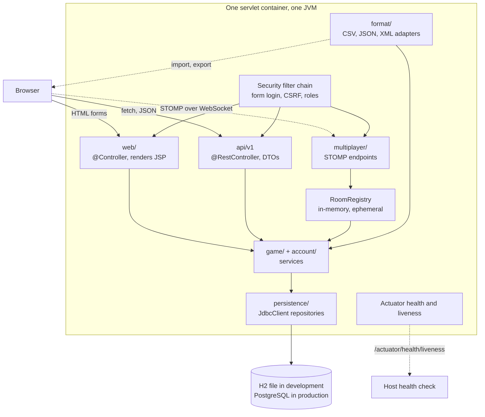

# Architecture

Where this is going for 2.0, and why the shape is what it is. Decisions with a number in
brackets are recorded in [DECISIONS.md](DECISIONS.md).

## The constraint everything hangs off

One free instance: a tenth of a CPU, 512MB, no disk, asleep after fifteen idle minutes. Every
visitor pays for the cold start. That has already shaped the build: the JSPs are compiled by
Maven instead of by Jasper on first request, and the JIT is capped at tier one. It goes on shaping
2.0.

So boot time and resident memory are budgets, not afterthoughts. Every dependency below says what
it buys and what it costs in measured megabytes and seconds, and a dependency that cannot justify
its share does not go in [12]. The garbage collector is pinned rather than left to ergonomics, for
the same reason: the JVM picks it from how many CPUs it thinks it has, and on this host that is
not a number to trust [17].

## Runtime pieces



The dotted WebSocket line is the only piece that is not a plain request/response, and its state
is the only state that is not in the database [10].

## Packages

Root stays `com.example`. The subpackages are renamed to lowercase, which is both idiomatic and a
chance to name things after what they now do:

```
com.example
  Main                     boot entry point, WAR initialiser
  config/                  SecurityConfig, OpenApiConfig, WebSocketConfig
  web/                     @Controller, the JSP-rendered pages
  api/v1/                  @RestController, and dto/ next to it
  game/                    Question, Round, RoundService, scoring
  account/                 CurrentPlayer, registration, UserDetailsService
  persistence/             repositories over JdbcClient, row mappers
  format/                  CSVAdapter, JSONAdapter, XMLAdapter, and the registry
  multiplayer/             RoomRegistry, GameRoom, STOMP controllers
  support/                 DataDirectory, RequestIdFilter, LoginAttemptService
```

Do the rename as one mechanical commit with no behaviour change, early, so the later milestones
are not building on top of names that are about to move.

### Layering rules

- `web/` and `api/` call services. Neither touches a repository.
- Nothing below `web/` and `api/` imports `jakarta.servlet`. If a service needs the current
  player it takes `CurrentPlayer`, not `HttpSession`.
- No persistence type appears in `api/v1/dto`. DTOs are separate records with their own field
  names, so a column rename is not an API break [7].
- `format/` depends on the JDK, Jackson and opencsv, and on nothing else in the app. It does not
  know a database exists. That is what keeps import and export honest about being a format layer
  rather than a second datastore [3].
- `multiplayer/` may call `game/`. `game/` never calls `multiplayer/`.

Nothing enforces these but review. ArchUnit would, and it is test-scope so it costs no boot time,
but with one maintainer and a review gate it is not earning its keep yet. Add it the first time
a violation actually lands.

## Where today's classes end up

| Today | After | Note |
| --- | --- | --- |
| `Controller/*` | `web/*` | Same routes, same URLs. `LoginController.signIn` is deleted; the security filter takes the POST [6] |
| `Authentication/Login` | deleted | Replaced by `UserDetailsService` + `DaoAuthenticationProvider` |
| `Authentication/User` | `account/CurrentPlayer` | Renamed to stop colliding with Spring Security's `User` |
| `Authentication/ProxyUser` | `account/SecurityContextPlayer` | Still a proxy, but over the security context instead of a mutable session field [6] |
| `Authentication/RealUser` | `account/Player` + `PlayerPrincipal` | The record, and the `UserDetails` the framework wants |
| `Authentication/CreateUser` | `account/RegistrationService` | Writes to the users table |
| `Authentication/Registration` | `account/RegistrationForm` | Static validator becomes a record with constraints, once validation lands at M3 |
| `Database/Database` | `format/RowFormat` | Interface changes from file paths to streams [3] |
| `Database/FileDatabase` | `format/RowFormats` | Still picks by extension |
| `Database/*Adapter` | `format/*Adapter` | Unchanged apart from the package and the stream signature |
| `Database/DataDirectory` | `support/DataDirectory` | Survives: it holds the H2 file and the legacy CSVs |
| `Game/Questions` | `persistence/QuestionRepository` | The "skip malformed rows" logic moves to the import path, which is where malformed rows actually come from |
| `Service/GameService` | `game/RoundService` | Loses `@SessionScope`; the session keeps a round id and nothing else [9] |

Two tests are named in the README as guards against bugs that already came back once. Both must
survive, re-expressed rather than deleted:

- `PlayControllerTest.twoSessionsKeepSeparateScores` becomes "two sessions hold two different
  round ids".
- `FormatAdapterTest.theXmlParserDoesNotResolveExternalEntities` is unaffected by any of this and
  must stay exactly as it is.

## Data model

Five tables, plain portable SQL, no vendor extensions, so one set of Flyway migrations runs on
both H2 and PostgreSQL [2].

```
categories(id, name unique)

questions(id, text, option_1..option_4, answer, category_id, difficulty, created_at)
  check (answer in (option_1, option_2, option_3, option_4))
  check (difficulty in ('EASY','MEDIUM','HARD'))

users(id, username unique, display_name, password_hash, role, enabled, created_at)

rounds(id, user_id null, mode, started_at, finished_at, score, correct_count, wrong_count)

round_questions(round_id, position, question_id, served_at, answered_at,
                answer_given, correct, points)
  primary key (round_id, position)
```

Four option columns rather than a child table. It matches the domain, the CSV format and the
demo, and it saves a join on the hottest read. The ceiling: a two-option or six-option question
needs a migration. That is a fine trade for a game that has only ever had four.

The `answer in (option_1..4)` check is the one constraint worth arguing for. Today an import can
store a question whose answer matches none of its options, and it is unanswerable. The check
makes that impossible in the one place nothing can bypass.

`rounds.user_id` is nullable, so a guest round is stored like any other. Guests still get no score
history; that is now a `where user_id = ?` in the query rather than a decision about what to
write. The server-authoritative timer needs a durable `served_at` for guests too, so there was no
choice about it anyway.

No retention policy. Add a nightly delete of unfinished rounds older than a day when the table is
big enough to notice, which at ten questions a round will be a while.

## What each milestone changes

### M1: persistence

Flyway migrations create the schema and seed the shipped questions [1]. Repositories go in over
`JdbcClient` [4]. H2 for development, PostgreSQL in production, chosen by profile. The production
profile carries no default URL at all, so a misconfigured boot fails instead of quietly starting on
a throwaway database [2]. Every migration is additive, because a rollback onto a destructive one
starts clean and only fails later, under a user [14].

The three adapters stop being the datastore and become what they always were: a format layer.
Their interface moves from file paths to streams, which is what lets export stop writing a scratch
file into a directory the production instance does not have [3].

A development-profile migrator reads the legacy `userData.csv`, `StatData.csv` and any
locally-imported `QuestionData.csv` through the CSV adapter and inserts them, so a developer's
existing accounts survive the upgrade. It does not exist under the production profile, because
there has never been a production row to migrate [5]. The adapters' first job in their new role is
the migration off themselves, which is a fair test of whether the seam was where it looked.

### M2: security

`spring-boot-starter-security` with one `SecurityFilterChain` bean. The pom comment this replaces
says the starter "would put a login wall in front of every route". True of the auto-configured
default, and not true once there is an explicit chain [6]. The rules:

- public: `/`, `/menu`, `/play/**`, `/questions`, `/questions/export`, `/loginMenu`, `/createUser`,
  `/guest`, static assets, `GET /api/v1/**`, `/actuator/health/**`
- authenticated: `/stats`, `/questions/import`, writing `/api/v1/**`
- `ROLE_ADMIN`: the rest of `/actuator/**`, question management

A guest is an anonymous authentication, which is exactly the state `ProxyUser` modelled by hand.
Guest play does not need a special case; it needs the absence of one.

CSRF comes on by default and every existing form gets a hidden token. JSP reaches it through
`${_csrf.parameterName}` and `${_csrf.token}` with no taglib, so no dependency and nothing new on
the JspC classpath. The API keeps CSRF too, with a cookie repository, rather than the usual
`ignoringRequestMatchers("/api/**")`. The API is authenticated by the same session cookie, so
turning CSRF off there would turn it off everywhere that matters [8].

Existing hashes are raw BCrypt with no `{id}` prefix, so the `PasswordEncoder` bean stays an
explicit `BCryptPasswordEncoder`. Installing Spring's `DelegatingPasswordEncoder` would make every
existing password stop matching. If algorithm agility is ever wanted, backfill `{bcrypt}` prefixes
in a migration first.

Sign-out becomes a POST. A GET that logs you out is CSRF-able, and the nav link changes to a small
form.

Throttling is an in-memory map keyed by username, fed by `AuthenticationFailureBadCredentialsEvent`,
with a cap on entries. One instance, so no shared store, and no cache dependency for what a
`ConcurrentHashMap` does. If this ever runs on more than one instance the counter has to move to
the database.

Behind the host's TLS terminator, `server.forward-headers-strategy=framework` needs to be set or
Spring Security's redirects come back as `http://`. Worth confirming against the running instance
rather than taking on faith.

CSP belongs in this milestone too, and there is one thing in the way of it. `fragments/head.jspf`
ships an inline `<script>` so the theme is set before first paint, which means `script-src` cannot
be `'self'` alone. The fix is a per-response nonce generated in a filter and read by the JSP, not
`'unsafe-inline'`, which would give away the whole header. Worth doing here rather than later: the
views already escape everything through `<c:out>`, and CSP is what turns that discipline from a
convention into something the browser enforces.

### M3: REST API

`/api/v1`, `@RestController`, records for DTOs, hand-written `from(...)` factories rather than a
mapping library. `jakarta.validation` on request records for anything a client sends.

Errors are RFC 7807 through Spring's own `ProblemDetail` and a
`@RestControllerAdvice extends ResponseEntityExceptionHandler`. No problem-details library: the
framework has had this since Boot 3.

No springdoc at runtime. It measured +12.4 MB RSS and +6.7 MB of artifact for a document that
does not change between deploys, so the OpenAPI JSON is generated at build time and published next
to the Pages demo instead [15]. The API still has a browsable reference; the running instance does
not pay for it on every cold start.

`@Controller` and `@RestController` stay in separate packages. A `String` return means one thing
in one and another thing in the other, and mixing them in a codebase with a JSP view resolver is
how you get a 500 that says `WEB-INF/views/{"id":1}.jsp`.

### M4: game depth

Categories, difficulty, a per-question timer, streaks, a leaderboard.

The timer is the part with architectural content. `round_questions.served_at` is written when the
question is handed out, and elapsed time is computed server-side on submit from that column plus a
grace window for network latency. Nothing the client sends about time is trusted, which is the
whole point of calling it server-authoritative.

Question order is randomised per round and stored as the `position` column. Option order is
shuffled deterministically from `(round_id, question_id)` rather than stored, because answers are
compared by text. Display order does not affect correctness, so a refresh reshuffling is
harmless. Changing that hash reshuffles a live round's options mid-round, which is the ceiling on
the shortcut.

This is the milestone where `GameService` stops being session-scoped [9], because a durable
`served_at` and a service that a multiplayer room can also call are the same requirement.

It also breaks something the docs promise: CONTRIBUTING says `site/demo.js` scores the same way
`GameService` does. Streaks can follow into the demo cheaply; a server-authoritative timer cannot
follow into a page with no server. Extend the demo for streaks and change CONTRIBUTING to say
plainly which parts the demo does not implement, rather than letting the claim quietly go stale.

### M5: multiplayer

`spring-boot-starter-websocket` with STOMP over a simple in-JVM broker. No external broker: one
instance, so there is nothing to broker between [10].

A room is a host-generated code, a player list, a question cursor and a scoreboard, held in a
`ConcurrentHashMap` in a singleton registry. Room state is deliberately not persisted. A room that
survived a restart would be a room whose players are gone and whose sockets are dead. What does
get persisted is the outcome: when a room's game ends, each player's round is written to `rounds`
and `round_questions` exactly like a solo round, and the leaderboard cannot tell the difference.

Caps are a boundary, not a nicety: a limit on concurrent rooms and players per room, and a
scheduled reaper for idle rooms. 512MB and an open room-creation endpoint is otherwise a
one-request denial of service.

Reveals are scheduled one-shot on a `TaskScheduler` ("advance this room at T+20s"), not polled
every second. At a tenth of a CPU the difference between one timer per question and one tick per
second per room is the difference between free and not.

STOMP messages do not pass through the servlet filter chain, so authorisation on message
destinations is configured separately, and the handshake's allowed origins are the app's own
origin rather than `*`.

The honest limit, and it belongs in the README rather than being discovered by a visitor: an
instance that sleeps after fifteen idle minutes cannot host a reliable synchronous game. Two
players who both arrive cold will wait out the boot together, and a mid-game recycle ends the game.

### M6: observability

Actuator, graceful shutdown via `server.shutdown=graceful`, and no metrics backend [16].

Structured logs use Boot's own `logging.structured.format.console`, which has been built in since
3.4, so no encoder dependency. Correlation ids are a fifteen-line `OncePerRequestFilter` that puts
a request id in the MDC, taken from `X-Request-Id` when the caller supplies one, and clears it
in a `finally`. Not distributed tracing: there is one service, so there is nothing to propagate
to, and the tracing bridge plus Brave is a lot of boot time for a correlation id [11].

The host health check moves from `/` to `/actuator/health/liveness`, and this stops being a
preference the moment M2 lands. Measured: with the security chain on, `/` answers 401 to a request
with no `Accept` header and 302 to the login page with a browser's. Neither is 2xx, so the deploy
never goes live. The liveness probe is also the right question. The composite `/actuator/health` goes
503 when the database is unreachable, which would have the host restart an instance whose only
problem is a sleeping database.

Only `health` and `info` are public. Everything else is behind `ROLE_ADMIN`.

### M7: frontend, landed

JSP stays. It is the honest stack, it has no build step, and swapping it for a framework would
replace the thing the project is actually about with a thing every other project is about.

The shared chrome is four static includes under `WEB-INF/views/fragments/`: `head.jspf`,
`header.jspf`, `footer.jspf`, and `feedback.jspf` for the verdict on the answer just given. Static
includes resolve at compile time, so the JspC precompile step still covers every view. `base.css`
holds the design tokens and the shared components and the four remaining per-page stylesheets sit
on top of it; `play.css` and the background image are gone.

Theming is CSS custom properties and `color-scheme` in three layers: light by default,
`@media (prefers-color-scheme: dark)` for anyone who has not chosen, and an explicit `[data-theme]`
that beats both. An inline script in `head.jspf` reads `localStorage` and sets `data-theme` before
first paint, so a dark-theme reader gets no white flash, and `theme.js` loads deferred and wires
the toggle. The toggle button ships `hidden` and that script reveals it, so a browser with no
JavaScript gets no control rather than a dead one.

The accessibility work that landed: a skip link, a `:focus-visible` ring, `aria-current="page"` in
the nav, a labelled `<nav>`, the round progress as a real `role="progressbar"` with min, max and
now, the option group as a `<fieldset>` labelled by the question heading through `aria-labelledby`
instead of a duplicated legend, `alt=""` on the decorative brand mark, and a
`prefers-reduced-motion` block. The hamburger menu is gone: the nav fits at every width, so there
is no disclosure widget left to make accessible.

Genuinely still open, as opposed to tidying:

- Contrast ratios are chosen, not measured. The tokens look deliberate and nothing has put a
  checker over them in both themes.
- `header.jspf` only renders the sign-in or sign-out item when an `authKnown` flag is set, because
  only four of the eight views put `authenticated` in the model. That flag exists because
  authentication state is not available to every view, which is exactly what M2 fixes. Once the
  security context is the source of truth the nav can ask directly and `authKnown` goes.
- `feedback.jspf` marks the verdict `role="status"`. A live region that already holds content when
  the page loads is not reliably announced as a change, so this wants checking against a real
  screen reader rather than trusting the attribute.
- The progress bar rounds its width in EL with `fn:substringBefore(..., '.')`. It works, and it
  belongs in the model.

## Dependency budget

Numbers are measured deltas against the current artifact, not estimates.

| Dependency | Milestone | Buys | Costs |
| --- | --- | --- | --- |
| `spring-boot-starter-jdbc` | M1 | Connection pool, `JdbcClient` | +2.6 MB RSS, +0.25 s startup |
| `flyway-core` + `flyway-database-postgresql` | M1 | Versioned schema | Migration scan at boot |
| `h2` | M1 | Development and test datastore | Small |
| `postgresql` | M1 | Production driver | Driver only |
| `spring-boot-starter-security` | M2 | CSRF, session fixation, roles, form login | Filter chain, ~1.5MB. Absorbs `spring-security-crypto`, which stops being a direct dependency |
| `spring-boot-starter-validation` | M3 | Constraints at the trust boundary | Hibernate Validator bootstraps at startup |
| `spring-boot-starter-websocket` | M5 | STOMP, in-JVM broker | Moderate; only if M5 ships |
| `spring-boot-starter-actuator` | M6 | Health, liveness and readiness probes | Small |

Measured and rejected: `spring-boot-starter-data-jpa` at +26.3 MB RSS, +16.1 MB metaspace,
+4.25 s startup and +29.1 MB artifact [4]; `springdoc-openapi-starter-webmvc-ui` at +12.4 MB RSS
and +6.7 MB artifact [15]; `micrometer-registry-prometheus` at +14.8 MB RSS [16].

Not added, on purpose: JPA and Hibernate [4], springdoc [15], a metrics registry [16], Lombok,
MapStruct, a problem-details library, a logging encoder, a tracing bridge [11], Redis,
Testcontainers, Thymeleaf, any JavaScript framework or build step, `spring-security-taglibs`,
ArchUnit.

## What does not change

WAR packaging, Java 17, Maven, JSP views. `mvn -B clean verify` stays the one gate, and the JaCoCo
floor stays where it is. New code arrives with tests or the floor catches it, which is what the
floor is for. `tomcat-embed-jasper` stays `provided`. The build keeps precompiling the JSPs,
because the cold start that justified it has not gone anywhere.
